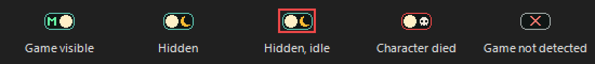
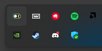
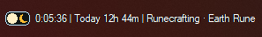
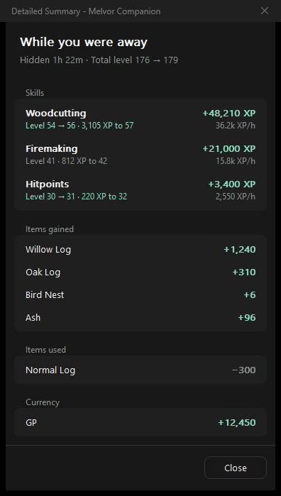
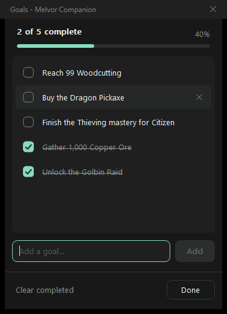

# Melvor Companion

**Hide Melvor Idle 2 away from your screen, in your system tray while it keeps playing.**

includes a few QOL features, such as what you're training at a glance, tracking goals, and a summary of what was earned while it was hidden.

A small, lightweight, free Windows app for the Steam version of Melvor Idle 2. The portable executable includes the C++ runtime.

> **Windows only for now.** Melvor Companion runs on Windows 10 and 11.

> **Unofficial.** Melvor Companion is a fan-made tool. It is not affiliated with or endorsed by Games by Malcs. Melvor Idle is their trademark.



> Download the Windows x64 ZIP from the [latest release](https://github.com/vani5h/melvor-companion/releases/latest), extract it, and run `MelvorCompanion.exe`.

## Features

- **Hide and show the game in one click.** Double-click the switch icon, or turn on a keyboard shortcut (**Ctrl+M** by default). Melvor keeps running in the background and its sound is muted while hidden.
- **A glance at your progress.** Hover the icon to see how long the game has been hidden and, optionally, what your character is doing, read from your latest save.
- **"While you were away".** When you show the game again, get a summary of the XP, levels, items, and GP you earned. Choose a quick notification or a **Detailed Summary** window with XP per hour and more.
- **Idle and death warnings.** If your character stops training while the game is hidden, you get a notification and the icon gets a red box. If your character dies you get a notification and the icon displays a skull. Changing characters resets the tracker.
- **Goals.** A simple checklist for your plans: add, check off, rename, reorder.
- **Hidden in Tray.** Companion can be chosen to stay hidden in the tray menu [1], or visible in the taskbar [2].
- **Taskbar widget.** Show the switch and your session time or current activity right on the taskbar.
- **Launch through Steam** from the tray menu, optionally hiding the game as soon as it starts.

<table>
  <tr>
    <td align="center" valign="bottom"><br><sub><b>[1]</b> In the tray</sub></td>
    <td align="center" valign="bottom"><br><sub><b>[2]</b> On the taskbar</sub></td>
  </tr>
</table>

    

## Getting started

1. Extract the Windows x64 ZIP from the [latest release](https://github.com/vani5h/melvor-companion/releases/latest) into a folder you will keep.
2. Run it. Windows may show a SmartScreen warning because the app is new and not code-signed: choose **More info**, then **Run anyway**.
3. Look for the switch icon in the notification area by the clock. On Windows 11 new icons start hidden under the **^** arrow; drag it onto the taskbar to keep it visible.

   

4. Right-click the icon for the menu. Turn on **Start with Windows** if you want it running every time you sign in.

The switch shows a mint **M** while Melvor is visible, an amber moon while it's hidden, and a gray **×** when Melvor isn't running. While hidden, a red box means your character went idle, and a red switch with a skull means your character died.

## Detailed Features

|  |  |
| --- | --- |
| Hide or show Melvor | Double-click the icon, or use **Hide game** / **Show game** in the menu |
| Use a keyboard shortcut | Turn on **Enable hotkeys** (**Ctrl+M** by default) |
| Hover the icon | Lists time hidden, character name, and current activity.  |
| Show it on taskbar | Displays useful information on taskbar, such as current activity, hidden time total, etc. |
| Start Melvor | **Launch Melvor (Steam)** in the menu (shown when the game isn't running) |
| Hide Melvor automatically on launch | Turn on **Hide Melvor when it starts** |
| Edit goals | **Goals...**: Enter adds, Space checks off, F2 renames, drag or Ctrl+↑/↓ reorders, Delete removes (or just use your mouse)|
| Choose summaries and warnings | **Notifications** submenu |

Showing the game brings it back behind your current window, so it doesn't force the screen on it. Exiting Melvor Companion always shows the game again first.

If the companion closes unexpectedly while Melvor is hidden, reopen the companion. It recognizes the window it previously hid and shows it once, even with **Start minimized** enabled.

**Notes**

- Activity and summaries come from your **save file**, which Melvor writes about every ten seconds, so they can lag slightly behind the game.
- With several characters, the most recently saved one is shown.
- The **taskbar widget** may fail for specific instances. It finds space beside the notification area, shrinks to just the icon on a crowded taskbar, and falls back to the regular tray icon when there's no room. On a taskbar docked to the left or right it shows the switch alone, just above the notification area. With an auto-hiding taskbar it slides away and back with the taskbar. Multiple monitors are not well tested yet. If it fails for any reason, please let me know or open an issue.

## Possible Issues

- IF MI2 stays muted while opened, manually unmute it in volume mixer

## Updating

Exit the running companion, extract the new ZIP, and run `MelvorCompanion.exe`. Existing Melvor Switch settings and goals carry over. If an older copy is still running, Melvor Companion offers to close it for you (showing the game first if it was hidden) and start the new one. Your settings and goals are kept.

To hear about new versions, turn on **Check for updates** in the menu. It asks GitHub once a day and shows **Update available** at the top of the menu.

If Melvor updates its save format, Melvor Companion checks whether it can still read it correctly. If not, the activity shows **Update needed** until a matching Melvor Companion release is out. Hiding and showing the game keeps working either way.

## Uninstalling

1. Turn off **Start with Windows** in the menu, then choose **Exit**.
2. Delete `MelvorCompanion.exe`.
3. Optional, to remove everything: delete the registry key `HKEY_CURRENT_USER\Software\Melvor Companion` (settings and goals) and the folder `%LOCALAPPDATA%\Melvor Companion` (a small log).

## Privacy

- Melvor Companion **reads** your local Melvor save files to show activity and summaries. It never changes them, never touches the game's files, and does not inject anything into the game.
- Nothing about you or your game is sent anywhere. The only network access is the optional **Check for updates**, which asks GitHub for the latest release number.
- Settings stay on your PC, in your Windows account's registry.

## Troubleshooting

- **I can't find the icon.** Check under the **^** arrow by the clock. Starting Melvor Companion again while it's running shows a notification pointing to it.
- **Nothing happens when I start it.** It's probably already running; see above.
- **"Game not detected".** Melvor Companion looks for the Steam version of Melvor Idle 2. Make sure the game is running from Steam.
- **"Activity unavailable" or "Update needed".** No save could be read yet, or the save format changed after a game update. Check for a newer Melvor Companion.
- **Something else.** Open **About Melvor Companion** in the menu and use **Open the log folder**; the log helps when reporting an issue.

## Requirements

Windows 10 or 11 (tested on Windows 11) and the Steam version of Melvor Idle 2. Windows only for now; macOS may come later.

## Building from source

### 1. Download the source for the version you want

Open the [releases page](https://github.com/vani5h/melvor-companion/releases), choose a version, and download **Source code (zip)** under **Assets**. Extract it somewhere you can easily find. Open the extracted folder that contains `CMakeLists.txt` and `src`. Copy its path from File Explorer’s address bar. This method works without Git.

### 2. Install the Windows build tools

In the Visual Studio Installer, select **Desktop development with C++**. In the installation details, make sure the **MSVC x64/x86 build tools**, a **Windows SDK**, and **C++ CMake tools for Windows** are selected. The standalone Build Tools edition is sufficient. [Microsoft’s installation guide](https://learn.microsoft.com/en-us/cpp/build/vscpp-step-0-installation)

### 3. Compile a 64-bit Release build

From the Windows Start menu, open **x64 Native Tools Command Prompt** for your Visual Studio installation. This prompt sets up the compiler and SDK for you. Change to the source folder, replacing the example path with the one you copied. Keep the quotes if the path contains spaces.

```bat
cd /d "C:\Projects\melvor-companion"
```

Run these commands in order. The first uses CMake to generate an x64 Visual Studio project in the `build` folder. The second uses MSVC to compile and link the Release executable.

```bat
cmake -S . -B build -A x64
cmake --build build --config Release
```

### 4. Run your copy

If Melvor Companion is already running, right-click its switch icon and choose **Exit**. Run your newly built executable from the same prompt.

```bat
build\Release\MelvorCompanion.exe
```

## License

Melvor Companion is free and open source under the [MIT License](LICENSE). It includes the Brotli decoder by the Brotli Authors, also under the MIT License; see [THIRD_PARTY_NOTICES.md](THIRD_PARTY_NOTICES.md).

Melvor Idle is a trademark of Games by Malcs. Melvor Companion is an unofficial fan project and is not affiliated with or endorsed by them.
